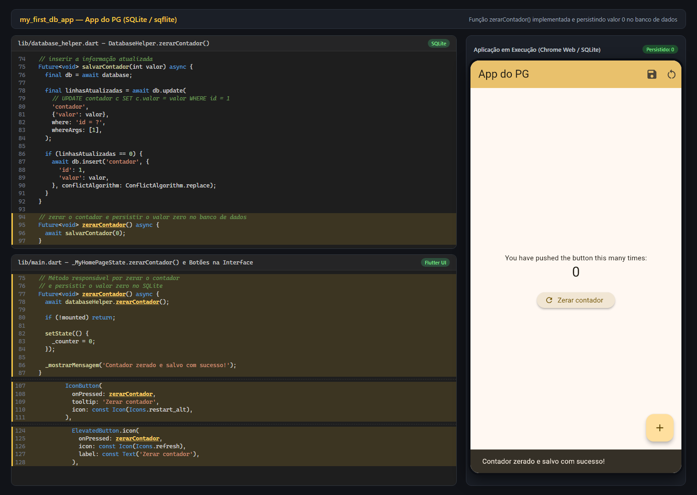

## Prints da Aplicação

- **Aplicação rodando + código `zerarContador()`**: [`prints/print_aplicacao_e_codigo.png`](prints/print_aplicacao_e_codigo.png)
- **Contador zerado e persistido**: [`prints/print_app_rodando.png`](prints/print_app_rodando.png)
- **Contador incrementado e salvo**: [`prints/print_app_incrementado.png`](prints/print_app_incrementado.png)

